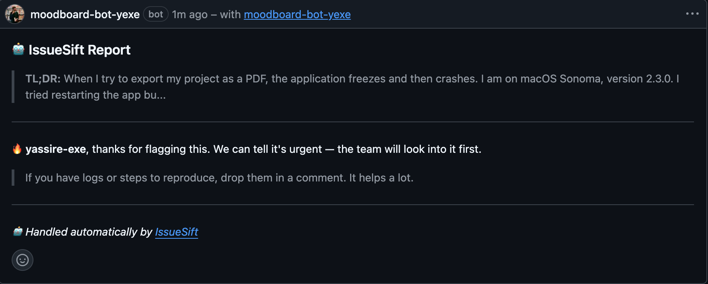

# IssueSift

**The intelligent issue triage for maintainers.**

## Why IssueSift?

Managing an open-source project should be about building great software, not drowning in an endless stream of GitHub issues.

As projects grow, maintainers face an increasing number of bug reports, feature requests, and support questions. Important issues can easily get buried, urgent problems may go unnoticed, and manually sorting through every report consumes valuable development time.

**IssueSift automates issue triage so maintainers can focus on what matters most.**

Built with Node.js, IssueSift analyzes the emotional tone of incoming issues, detects whether they are written in French or English, generates concise summaries, and automatically assigns urgency levels.

The goal is simple: make issue management faster, smarter, and more efficient for open-source communities.

## Features

- **TL;DR Summarization** — Generate concise summaries that highlight the core problem, helping maintainers understand issues at a glance.
- **Language Detection** — Automatically detect French and English issues to support multilingual projects.
- **Emotional Tone Analysis** — Analyze the emotional tone of issue descriptions to identify frustration, urgency, confusion, and other relevant signals.
- **Smart Assignment** — Automatically determine urgency levels and help prioritize issues according to their importance.
- **Auto-Labeling** — Apply relevant GitHub labels to organize issues and streamline the triage workflow.

## Quick Start

### Prerequisites

Make sure you have the following installed:

- [Node.js](https://nodejs.org/) (LTS recommended)
- npm
- [Git](https://git-scm.com/)
- [ngrok](https://ngrok.com/) (for local testing)

### 1. Clone the repository

    git clone https://github.com/yassire-exe/issue-sift.git
    cd issue-sift

### 2. Install dependencies

    npm install

### 3. Create your GitHub App

1. Go to your GitHub Settings > Developer settings > GitHub Apps > New GitHub App.
2. Set the **Webhook URL** to your public server (e.g., your ngrok URL + `/webhook`).
3. Set a **Webhook Secret** (keep it safe).
4. Grant **Read & write** access to **Issues** and **Read-only** access to **Metadata**.
5. Subscribe to the **Issues** event.
6. Generate a **Private Key** and save it as `private-key.pem` in the project root.

### 4. Configure environment variables

Create a `.env` file in the project root:

    APP_ID=your_github_app_id
    WEBHOOK_SECRET=your_webhook_secret
    PRIVATE_KEY_PATH=./private-key.pem
    PORT=3000

Replace the values with your actual GitHub App configuration.

**Important:** Never commit your `.env` file or your `private-key.pem` file to version control.

### 5. Start IssueSift

    node index.js

If your environment is configured correctly, IssueSift should start and listen on port 3000. Ensure your GitHub App webhook is pointing to your active server.

## Contributing

Contributions are welcome! IssueSift is an open-source project, and improvements from the community help make issue triage more accessible and effective.

### How to contribute

1. Fork the repository.
2. Create a feature branch for your changes.
3. Implement your changes and add tests where appropriate.
4. Verify that your changes work as expected.
5. Commit your changes with a clear, descriptive message.
6. Push your branch to your fork.
7. Open a pull request explaining the changes and their purpose.

### Contribution guidelines

- Keep changes focused and maintainable.
- Follow the existing code style and project conventions.
- Document new features, configuration options, and behavioral changes.
- Avoid committing secrets, API keys, or personal access tokens.
- Include tests for new functionality and bug fixes whenever possible.
- Be respectful and constructive when reviewing issues and pull requests.

Before submitting a significant change, consider opening an issue to discuss the proposed implementation.

## License

IssueSift is distributed under the MIT License.

You are free to use, copy, modify, merge, publish, distribute, sublicense, and sell copies of the software, subject to the terms and conditions of the MIT License.

See the [LICENSE](./LICENSE) file for the full license text.

---

*Built by [Yassire](https://github.com/yassire-exe)*

